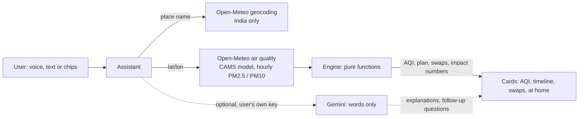

# Saans

Tell Saans who lives in your home and what your day looks like. It gives you a smog-safe plan for today, and every suggestion shows how much pollution it keeps out of your lungs and out of the air.

Entry for Hack2skill PromptWars Virtual, Challenge 6 ("Urban Air Quality Assistant").

## Brief → feature mapping

| Brief requirement              | Saans feature                                                                                                    |
| ------------------------------ | ---------------------------------------------------------------------------------------------------------------- |
| Families and communities       | Household profile gathered by conversation: children, elders, anyone with asthma or breathing trouble, commuters |
| Tailored to location           | Live AQI for the user's city or area (any Indian city), by voice, typing, or browser geolocation                 |
| Low-emission daily routines    | Today's plan in morning / afternoon / evening blocks: when to go out, when to stay in, how to travel             |
| Indoor air quality hacks       | At home card: when to open or close windows, purifier timing, cooking and incense tips, tied to forecast hours   |
| Sustainable alternatives       | Swaps: metro or bus instead of cab, carpooling, combining trips, walking short hops in cleaner hours             |
| Clearly explains direct impact | Each swap shows two numbers: less PM2.5 inhaled and kg CO₂ saved, plus a one-line "why" written by Gemini        |

## How it works

Saans is a static web app: there is no backend. Everything runs in the browser.



**The golden rule:** every number on screen comes from Open-Meteo or from `src/engine`. Gemini never produces an AQI, pollutant, forecast or impact number; it only writes explanations and follow-up questions. Without a Gemini key the app still works, using template text.

### Code layout

| Folder                                | What it does                                                                                                                                                                                    | Status        |
| ------------------------------------- | ----------------------------------------------------------------------------------------------------------------------------------------------------------------------------------------------- | ------------- |
| `src/types.ts`                        | zod schemas and types for every data shape (location, air reading, forecast, household, plan, assistant turn)                                                                                   | Done          |
| `src/engine/`                         | Pure calculation engine: CPCB AQI, inhaled PM2.5 dose, CO₂ per trip, swap impact, best/worst forecast hours, indoor tips, day planner. 100% test coverage. See [docs/engine.md](docs/engine.md) | Done          |
| `src/data/`                           | Open-Meteo client: fetch with 5 s timeout and schema check, India-only place search, air quality + 48 h forecast, 10-minute cache                                                               | Done          |
| `src/plan/`, `src/chat/`, `src/i18n/` | Screens: AQI card, day timeline, swap cards, at-home card, chat, English/Hindi                                                                                                                  | Not built yet |
| `src/llm/`, `src/key/`                | Template assistant and Gemini assistant (bring your own key)                                                                                                                                    | Not built yet |
| `src/speech/`, `src/demo/`            | Voice input/output, demo families, "Try saying…" hints                                                                                                                                          | Not built yet |

## Data sources and attribution

- **Air quality and forecast:** [Open-Meteo Air Quality API](https://open-meteo.com/en/docs/air-quality-api), based on the Copernicus Atmosphere Monitoring Service (CAMS) model. Readings are modelled estimates on a ~40 km grid, not station measurements, and the app labels them that way. Contains modified Copernicus Atmosphere Monitoring Service information.
- **Place search:** [Open-Meteo Geocoding API](https://open-meteo.com/en/docs/geocoding-api), filtered to India.
- **AQI scale:** CPCB National Air Quality Index (2014), computed from the mean of the last 24 hourly PM2.5 and PM10 values.
- Why not CPCB or OpenAQ station data directly: both need an API key and neither allows direct browser calls, and Saans has no backend by design.

## Privacy and API keys

- No account, no backend, no database. Nothing about you leaves your browser except the city or coordinates sent to Open-Meteo.
- The Gemini key (optional, planned) is your own, kept in `sessionStorage` for the open tab only, and sent only to Google's Gemini API.

## Not medical advice

Saans gives general air-quality guidance. It does not diagnose, and it never names medicines or doses. If anyone at home has a health condition, follow your doctor's advice.

## Setup

```sh
npm install
npm run dev
```

Requires Node 22 or later (see `.nvmrc`).

## Scripts

| Script              | Purpose                             |
| ------------------- | ----------------------------------- |
| `npm run dev`       | Start the dev server                |
| `npm run build`     | Type-check and build the static app |
| `npm run preview`   | Serve the built app on port 4173    |
| `npm run lint`      | ESLint, zero warnings allowed       |
| `npm run typecheck` | TypeScript, no emit                 |
| `npm test`          | Unit tests with coverage            |
| `npm run test:e2e`  | Playwright end-to-end tests         |
| `npm run format`    | Prettier                            |

## Testing

- 156 unit tests (Vitest). Coverage: 100% statements and lines, 99% branches overall; `src/engine` is held at 100% by a coverage gate.
- Tests never call the network: Open-Meteo responses come from fixtures in `src/data/fixtures/`.
- Time-zone safety: tests run with `TZ=UTC` and forecast hours are kept in India time (IST), so the advice is right wherever the code runs.

## Project docs

- Design spec: [docs/superpowers/specs/2026-11-20-saans-design.md](docs/superpowers/specs/2026-11-20-saans-design.md)
- Build plan: [docs/superpowers/plans/2026-11-20-saans-plan.md](docs/superpowers/plans/2026-11-20-saans-plan.md)
- Engine and its numbers: [docs/engine.md](docs/engine.md)

## Still to write

Live link, demo video, screenshots, accessibility notes, deployment (Firebase Hosting), and "What GenAI did vs what I did" will be added as those parts are built.
