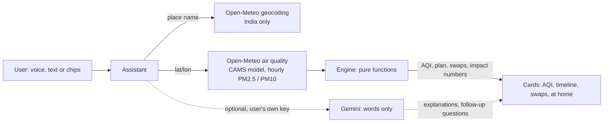

# Saans

Tell Saans who lives in your home and what your day looks like. It gives you a smog-safe plan for today, and every suggestion shows how much pollution it keeps out of your lungs and out of the air.

Entry for Hack2skill PromptWars Virtual, Challenge 6 ("Urban Air Quality Assistant").

**Live app:** https://soumyadipkarforma.github.io/saans/

## Brief → feature mapping

| Brief requirement              | Saans feature                                                                                                    |
| ------------------------------ | ---------------------------------------------------------------------------------------------------------------- |
| Families and communities       | Household profile gathered by conversation: children, elders, anyone with asthma or breathing trouble, commuters |
| Tailored to location           | Live AQI for the user's city and the exact area inside it (Dwarka, Delhi), by voice, typing, or geolocation    |
| Low-emission daily routines    | Today's plan in morning / afternoon / evening blocks: when to go out, when to stay in, how to travel             |
| Indoor air quality hacks       | At home card: when to open or close windows, purifier timing, cooking and incense tips, tied to forecast hours   |
| Sustainable alternatives       | Swaps: metro or bus instead of cab, carpooling, combining trips, walking short hops in cleaner hours             |
| Clearly explains direct impact | Each swap shows two numbers: less PM2.5 inhaled and kg CO₂ saved, plus a one-line "why" written by Gemini        |

## How it works

Saans is a static web app: there is no backend. Everything runs in the browser.



**The golden rule:** every number on screen comes from Open-Meteo or from `src/engine`. Gemini never produces an AQI, pollutant, forecast or impact number; it only writes explanations and follow-up questions. Without a Gemini key the app still works, using template text.

### Code layout

| Folder                                | What it does                                                                                                                                                                                    | Status |
| ------------------------------------- | ----------------------------------------------------------------------------------------------------------------------------------------------------------------------------------------------- | ------ |
| `src/types.ts`                        | zod schemas and types for every data shape (location, air reading, forecast, household, plan, assistant turn)                                                                                   | Done   |
| `src/engine/`                         | Pure calculation engine: CPCB AQI, inhaled PM2.5 dose, CO₂ per trip, swap impact, best/worst forecast hours, indoor tips, day planner. 100% test coverage. See [docs/engine.md](docs/engine.md) | Done   |
| `src/data/`                           | Open-Meteo client: fetch with 5 s timeout and schema check, India-only place search, air quality + 48 h forecast, 10-minute cache                                                               | Done   |
| `src/plan/`, `src/chat/`, `src/i18n/` | Screens: AQI card, day timeline, swap cards, at-home card, chat, English/Hindi                                                                                                                  | Done   |
| `src/llm/`, `src/key/`                | Template assistant and Gemini assistant (bring your own key)                                                                                                                                    | Done   |
| `src/speech/`, `src/demo/`            | Voice input/output, demo families, "Try saying…" hints                                                                                                                                          | Done   |

## Data sources and attribution

- **Air quality and forecast:** [Open-Meteo Air Quality API](https://open-meteo.com/en/docs/air-quality-api), based on the Copernicus Atmosphere Monitoring Service (CAMS) model. Readings are modelled estimates on a ~40 km grid, not station measurements, and the app labels them that way. Contains modified Copernicus Atmosphere Monitoring Service information.
- **Place search:** [Open-Meteo Geocoding API](https://open-meteo.com/en/docs/geocoding-api), filtered to India.
- **AQI scale:** CPCB National Air Quality Index (2014), computed from the mean of the last 24 hourly PM2.5 and PM10 values.
- Why not CPCB or OpenAQ station data directly: both need an API key and neither allows direct browser calls, and Saans has no backend by design.

## Privacy and API keys

- No account, no backend, no database. Nothing about you leaves your browser except the city or coordinates sent to Open-Meteo.
- The Gemini key (optional) is your own, kept in `sessionStorage` for the open tab only, and sent only to Google's Gemini API.

## Bring your own Gemini key

The app works fully without a key (template answers). With your own key from [Google AI Studio](https://aistudio.google.com/apikey), Gemini answers follow-up questions in words. It calls the same tools the app uses, and a number guard replaces any reply that states a number no tool produced.

- Model: `gemini-3.5-flash-lite` (the fastest stable Flash-family model; function calling confirmed on 2026-11-24). `gemini-3.8-flash` was tried as a fallback and returned 503 high demand, so there is no automatic fallback model: if Gemini fails, the app shows the template answer with a notice.
- Limits: 10 Gemini turns per minute, 25 s total per turn.

## Not medical advice

Saans gives general air-quality guidance. It does not diagnose, and it never names medicines or doses. If anyone at home has a health condition, follow your doctor's advice.

## Setup

```sh
npm install
npm run dev
```

Requires Node 22 or later (see `.nvmrc`).

## Scripts

| Script              | Purpose                             |
| ------------------- | ----------------------------------- |
| `npm run dev`       | Start the dev server                |
| `npm run build`     | Type-check and build the static app |
| `npm run preview`   | Serve the built app on port 4173    |
| `npm run lint`      | ESLint, zero warnings allowed       |
| `npm run typecheck` | TypeScript, no emit                 |
| `npm test`          | Unit tests with coverage            |
| `npm run test:e2e`  | Playwright end-to-end tests         |
| `npm run format`    | Prettier                            |

## Testing

- 156 unit tests (Vitest). Coverage: 100% statements and lines, 99% branches overall; `src/engine` is held at 100% by a coverage gate.
- Tests never call the network: Open-Meteo responses come from fixtures in `src/data/fixtures/`.
- Time-zone safety: tests run with `TZ=UTC` and forecast hours are kept in India time (IST), so the advice is right wherever the code runs.

## Try it in 30 seconds

1. Open the live app in Chrome, tap **Start live conversation**, then just answer when Saans asks. No key needed; it uses live air data.
2. Or tap **Try a demo family** → **Sharma family, Delhi** to watch a whole conversation play out.
3. Or type a sentence, for example:
   - "I live in Pune, I cycle to college and my dad has asthma"
   - "I live in Delhi, I drive 12 km to office and my son is 8"
   - "मैं लखनऊ में रहता हूँ, सुबह पार्क में टहलता हूँ"
4. Tap the follow-up chips: "Can my child play outside at 5?", "What if I work from home?", "Explain the AQI".
5. Optional: tap **AI: off** and paste your own Gemini key to let Gemini hold the conversation.

## Deployment

Every push to `main` runs `.github/workflows/deploy.yml`: lint, type-check, tests, then a build with `BASE_PATH=/<repo>/`, published to GitHub Pages. In the repository settings, set **Pages → Source** to **GitHub Actions** once.

## Project docs

- Design spec: [docs/superpowers/specs/2026-11-20-saans-design.md](docs/superpowers/specs/2026-11-20-saans-design.md)
- Build plan: [docs/superpowers/plans/2026-11-20-saans-plan.md](docs/superpowers/plans/2026-11-20-saans-plan.md)
- Engine and its numbers: [docs/engine.md](docs/engine.md)

## Live mode

Tap **Start live conversation** and talk to Saans like a phone call, with no more tapping:

1. Saans says hello and asks which city you are in.
2. You say "Delhi". It picks the capital (say "Delhi, Madhya Pradesh" if you meant another one) and asks **which part of Delhi** you live in.
3. You say "Dwarka". Saans finds Dwarka on the map near Delhi, not the Dwarka in Gujarat, and switches to the air reading right over that area.
4. It asks about your family ("Who's at home with you? Any kids, elders, or anyone with asthma?"), then how you travel, then what you plan to do today.
5. Your plan appears, and you can keep asking questions out loud.

The orb shows whose turn it is: listening, thinking or speaking. Tap it to interrupt Saans mid-sentence, or to pause the mic. **End live** stops the loop. If nobody speaks for two rounds, the mic pauses itself. Typing and the chips keep working the whole time.

## Voice

- **Speaking to Saans** uses the browser's speech recognition (Chrome and Edge; English `en-IN` and Hindi `hi-IN`). Typing and the tap chips always work too.
- **Saans speaking back** uses the browser's built-in voices (`speechSynthesis`), not Gemini, so it needs no key and costs nothing. It reads the first three sentences of each reply, skips the source note in brackets, and says units in words ("micrograms per cubic metre"). It prefers an Indian English voice, then British, then any English voice. The speaker button in the header mutes it.
- How good the voice sounds depends on the voices installed on the device. On Windows, Settings → Time & language → Speech → add "English (India)" for a better accent.

## Security

- Static site, no backend, no cookies, no analytics. Your household profile, language and mute choice are saved in this browser's `localStorage` so the plan survives a reload; nothing else is stored.
- The production build carries a Content-Security-Policy meta tag (added by a small Vite plugin in `vite.config.ts`): scripts only from the site itself, and network calls only to Open-Meteo (air quality, geocoding) and Google's Gemini API. `object-src 'none'`, `form-action 'none'`, `base-uri 'self'`.
- `Referrer-Policy: no-referrer`, so the city you search for never leaks in a referrer.
- No `dangerouslySetInnerHTML`; every reply is rendered as text.
- The Gemini key lives in `sessionStorage` only (gone when the tab closes), never in `localStorage`, files or the URL.
- All API responses are validated with zod before use; user text is capped at 500 characters.

## What GenAI did vs what I did

| | Who |
| --- | --- |
| Problem choice, the "numbers from code, words from AI" rule, household-first design | Me |
| Design spec and the 25-task build plan | Drafted with Claude Code from my brief, reviewed and changed by me (e.g. no backend, bring-your-own key, Open-Meteo only) |
| Code and tests | Written by Claude Code agents task by task; every task reviewed before it counted as done |
| Engine factors (breathing rates, place factors, CO₂ per km) | Taken from the cited sources in [docs/engine.md](docs/engine.md); marked as assumptions where they are |
| In the running app | Gemini (optional, your key) writes the words of replies. It never produces a number: the engine and Open-Meteo do, and a number guard checks every reply |
| Testing in the browser, live Gemini checks, deployment | Me, with Claude Code |
